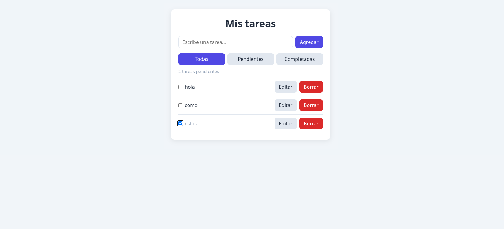

# App de Tareas

Aplicación de lista de tareas hecha con React y Vite. Permite organizar pendientes de forma rápida y guarda los datos en el navegador, así que no se pierden al recargar la página.

**Demo en vivo:** [todo-app en Vercel](https://todo-qk4kho39v-mahem.vercel.app)

## Funcionalidades

- Agregar, editar, completar y borrar tareas
- Filtros: todas, pendientes y completadas
- Contador de tareas pendientes
- Persistencia con localStorage
- Diseño responsive

## Tecnologías

- React (hooks: `useState`, `useEffect`)
- Vite
- CSS (variables, flexbox)
- Despliegue en Vercel

## Estructura del proyecto

    src/
    ├── components/
    │   ├── FormularioTarea.jsx
    │   ├── Filtros.jsx
    │   └── TareaItem.jsx
    ├── App.jsx
    ├── index.css
    └── main.jsx

## Cómo correrlo localmente

    git clone https://github.com/Cod7777/todo-app.git
    cd todo-app
    npm install
    npm run dev

Luego abre http://localhost:5173 en el navegador.

## Qué aprendí

- Manejo de estado con `useState` y efectos secundarios con `useEffect`
- Dividir la interfaz en componentes reutilizables y comunicarlos con props
- Derivar datos del estado (filtros y contador) en lugar de duplicarlos
- Persistir datos en `localStorage`
- Despliegue continuo con Vercel y GitHub

## Próximas mejoras

- Modo oscuro
- Categorías y fechas límite
- Pruebas con Vitest y React Testing Library
- Migrar a TypeScript

## Autor

**Cod7777** - [GitHub](https://github.com/Cod7777)
